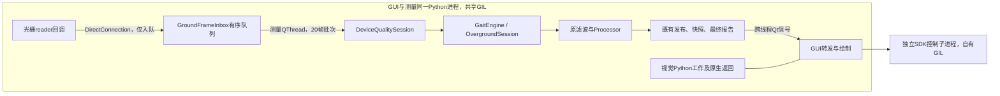

# 消费会话隔离边界审查：保留原处理链、时序和证据归属

模型单独移到子进程的四对固定工作只改善4.80%，低于冻结20%门槛。本阶段不追加这个候选，也不扩展CPU/栈工具。根据参考对话“消费者吞吐保障”的方向，审查一个更完整的实验隔离单位。

## 当前真实边界

`source_audit01.json` 逐文件SHA和AST定义行号绑定以下结论，源码未修改：

这些连线描述源码，不表示阻塞份额或已经确认的根因。`_engine.moveToThread` 同时迁移quality/inbox等子QObject；质量门到引擎同测量线程执行，GUI转发与绘制跨线程，但仍共享同一进程GIL。原reader的DirectConnection执行入队，不能误认为整个算法在该回调里执行。

`SessionController` 没有直接QtWidgets依赖，管理worker、QThread、质量门、inbox、引擎和最终报告，是一个比 `_consume()` 更完整的候选所有权边界。

## 只选择一个后续实验单位

将**完整原测量会话**放入独立QCoreApplication实验进程：原Source/UsbWorker、原inbox、原quality、原engine/filter/Processor和档案全部由该进程持有；父GUI保留视觉、相机/SDK及原绘图。初始交付只用保存Source，不打开USB。父子间传递会话命令与既有输出值，不用每帧RPC替代原有reader→inbox路径。

这是下一候选的边界选择，不是已实现的隔离，也不是对正式架构的修改。它与已失败的“仅模型隔离”不同；系统CPU、内存等仍共享，即使移除GIL共域也不能保证实时性。

| 原始语义 | 必须保留的进程边界要求 |
|---|---|
| prepare与start分离 | child执行原prepare；父GUI只能依据child返回的ready/device_key请求start，child仍执行原arm_checked复核 |
| 帧与arm顺序 | child内保留原队列、同线程arm命令及已有帧先消费规则；不能在父侧提前确认已armed |
| 数据时钟与布局 | 保留stream_id、sample/frame index、接收QPC、1000Hz设备时间、wire、valid bits、缺帧及段物理坐标；不补样、不压缩时间 |
| 坏束处理 | 调用原quality/filter逻辑；传输不得删掉第七段首坏束位置、重编号或新增自动连通。值保真不等于算法语义验收 |
| 既有发布和历史 | 事件、retraction及质量变化保持顺序，不丢弃或latest-only化；GUI数据需脱离child可变对象。不能把只保留最后一次显示当作完整事件传输 |
| 停止 | child冻结输入、排空inbox、halt/flush质量与滤波、停止worker、完成线程退出，之后原build_report；父确认报告不等于child进程已退出 |
| 超时/错误 | 保留PID、锁、最后输入/完成序号与故障；不得先发“完成”再异步丢弃未排空数据 |
| 存储与报告 | child拥有全部原始档案及原报告生成，父仅接收结果或验证过的文件引用；不得把报告构建留在GUI直接访问远程engine |

停止顺序尤其不能简化为杀进程：原 `_do_stop` 先finish inbox，再halt、停止worker/thread，然后构建报告。这个顺序必须在child内部保留。Qt对象与锁不能直接通过IPC传输，跨边界只能是数据与命令。已有GUI校准脚本直接访问controller私有engine/inbox；它不能不经改造就宣称适用于这个候选。

## 已完成的离线值检查

`test_values.py` 五项测试通过，0跳过：8段反向线序、坏束576保留6米物理坐标及768位长度、缺帧/stream切换不重编号、AcquisitionIssue位置信息、发布数据与原对象脱离、既有严重窗口的完整report值往返一致。使用同一主机可信进程的Python数据序列化，不传Qt对象。

这些只验证候选数据边界可表达，**没有证明运行中的IPC吞吐、原处理链结果或坏束事件算法正确**。既有完整report测试使用保留的GUI窗口，其SHA记在tests01.json，未新增采集或替换任何证据。

## 下一步的具体完成条件

先做独立保存输入交付验证：原SessionController会话在child内完整运行，父只接受ready/start/完成信号；验证所有输入、质量历史、事件/audit/timeline、原始档案和最终report与原基准一致，并确认排空与父子退出。再检验命令/输出的实际跨进程交付、会话身份与顺序、坏束物理坐标和多段布局，故障路径必须失败关闭并保留锁。

交付通过后才冻结并发负载/GUI性能对照；验收仍回到1000Hz输入、队列年龄/峰值、contact→paint以及严重基线可复现。不能把本次离线值检查或原模型进程收益当作性能完成，也不在可行性未证明前重构hardware/engine或更改DirectConnection。

本阶段没有Windows工作窗口、人体、USB、Run或优化A/B，没有修改正式程序。此前所有失败门槛和证据继续保留，根因与修复未完成。
