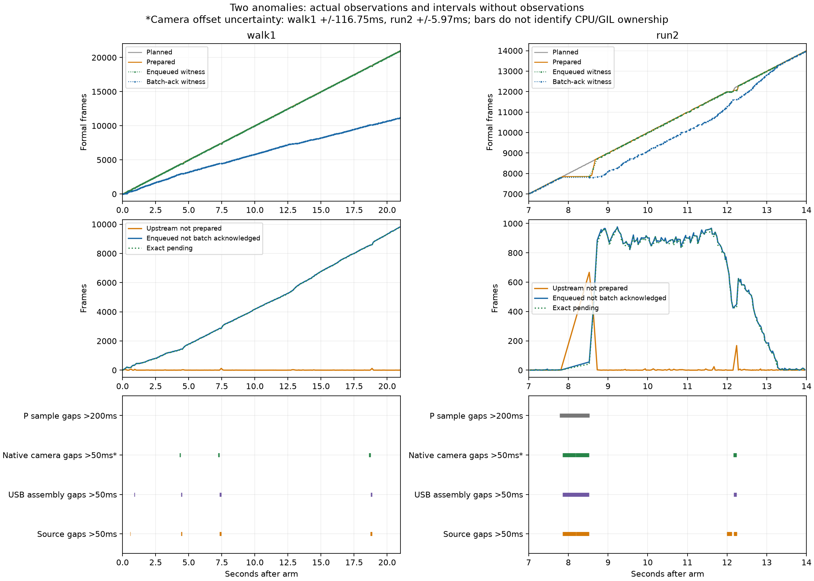

# 六轮历史时间线：上游迟到与下游处理不足同时存在

结论已能由历史数据验证：**走路第 1 轮以“数据已经进入 inbox，批次处理持续跟不上”为主；跑步第 2 轮先出现跨线程交付停顿，随后追赶发出，并形成下游积压。跑步同一时刻也能同时看到两类欠账。** 两个异常都有局部跨线程进展停顿的特征，但共同 CPU/GIL 根因尚未证实。

本轮只读已有六轮 `hardware` profile 文件。没有修改回放等待、观测器、NumPy、绘图候选、正式程序或旧证据；未开启设备、回放、WPR/ETW、新 A/A 或 A/B。基于 `c4141ec`，继续在隔离分支 `codex/ground-backlog-measurement`。所有新增文件在本目录。方法见 [method.json](method.json)，完整结果见 [summary.json](summary.json)。

## 如何对齐而不制造时间戳

对每一个已有的持锁快照，按同一个 Windows `perf_counter_ns` 时间重建四个累计计数：

- S：计划到该时刻应发出的帧数。
- A：已经记录过源线程时间的帧数。旧记录的“实际发出”时间实际位于构造 SensorFrame、追加记录和调用 signal 之前；本轮准确称为 **prepared**，不冒充 signal 返回或入队时刻。
- E：快照中 `latest_received_frame.sample_index` 对应的已入队帧数。`on_frame` 在同一把 inbox 锁下追加 pending 并更新 latest，这是实际入队见证。
- C：最后完整消费批次对应的累计数。它不是当前批次内部逐帧完成进度，也不是 CPU 独占计算量。

在全部 **4735 个**旧快照上逐个验证整数守恒：

`S − C = (S − A) + (A − E) + (E − C)`

分别对应：计划已过但尚未 prepared、prepared 后尚未入队、已入队但批次未确认。最后一项最多包含一批中已经处理过的帧，所以另外保留原始 **pending 队列长度**。六轮在快照处 `A−E` 都只有 0 或 1；这排除了大量“已 prepared 的帧卡在未观测 Qt 投递队列”的解释，但不证明单帧构造/emit/锁等待为零。

现有数据没有逐帧 enqueue 或每一批精确结束时间。因为源线程通过 `Qt.DirectConnection` 同步调用 inbox，非最后一帧的入队时刻不晚于下一帧 prepared 时间；再用最早的 locked latest 见证收紧上界。批边界确认时间用前后快照夹住。生成的 **180663 帧区间表**保存在本地 `frames/`，没有插值生成假的真实事件。`frames/` 不提交 Git；由脚本及输入 SHA-256 可重建。批边界区间不能用作逐帧独占计算耗时。

相机 CSV 的 `record_elapsed_seconds` 是独立的 native steady-clock 相对时间。仓库 C++ 源码显示它在 native 录像队列入队、Python 回调之前记录，既不是回调完成时间，也不是磁盘写完时间。实际 record-start 绝对时钟未保存；只能将其约束在原 checked 帧 prepared 与 `armed_ns` 之间。图用区间中点定位，走路 1 为 ±116.746 ms，跑步 2 为 ±5.974 ms；保留原生间隔原值，不声称微秒级跨时钟同步。对齐假设两种单调时钟的秒尺度一致，没有额外时钟漂移校准。

实际 USB 原件的时间则是 **Python assembler 收到完整帧时的时钟**，不是 USB 电气到达或 native `ReadDevice` 返回时钟。原生相机流随后同步进入 Python 回调，下一次 native on_frame 也可能受前一次回调等待影响；它是较低层时序旁证，仍不能独立定位 GIL。运行 DLL 哈希已有记录，C++ 记录点解释依据仓库源码；没有该 DLL 对应的符号化执行栈/build 对照，因此也不将源码调用顺序当成历史 CPU trace。

## 六轮初始空场对照

采用此前固定的“第一段空场”sample 区间，映射到**计划输入的主机时间窗口**；不是把同一时刻消费者已处理到的 sample 区间混在一起。走路约 0–11 秒，跑步约 0–7 秒。表中的 fps 用该窗口内首末已有快照计算。

| 轮次 | prepared fps | 实际入队 fps | 批边界推进 fps | 最大真实 pending | 最大计划未 prepared |
|---|---:|---:|---:|---:|---:|
| 走路 1 | 1000.0 | 1000.0 | **579.6** | **4604** | 117 |
| 走路 2 | 999.9 | 999.9 | 1000.1 | 15 | 6 |
| 走路 3 | 1000.1 | 1000.1 | 999.9 | 44 | 7 |
| 跑步 1 | 1000.2 | 1000.2 | 1000.0 | 8 | 5 |
| 跑步 2 | 1000.0 | 1000.0 | 999.7 | 145 | 7 |
| 跑步 3 | 999.9 | 999.9 | 999.9 | 7 | 5 |

“空场”沿用既有阶段定义，不隐去原始脉冲：走路 11000 帧剔除固定坏点 576 后，有 4 帧单束 64 脉冲（sample 53380、53410、53440、53470）；其余帧为零。跑步对应 7000 帧全为零。走路 1 的消费不足从这些脉冲到来/被消费前就存在，不能将整段下降归因于接触密集算法工作。

### 走路第 1 轮：下游持续处理不足已被确认

在 10.989863 秒这一实际快照：

- 计划未 prepared：**0**；prepared 未入队：**0**。
- 已入队但尚未整批确认：**4624**；其中真实 pending **4604**，当前批次 **20**。
- 最新入队 sample 59891，批边界只推进到 55267。

这说明数千帧已经进入 inbox。单纯修改源线程等待策略不能解释或消除这些已入队欠账。不是说每帧都准点：该窗口 prepared 迟到 P95/max 为 32.32/120.50 ms；但它不能替代上述真实队列证据。

P 独立采样在这段空场的大多数观察中看到消费者处于 batch 状态；它说明 `_consume` 已进入且尚未返回，不能把整个墙钟差额当成 Qt 尚未派发下一批，也不能把 batch 状态当作 CPU 一直 Running。7.332211 与 7.452173 秒看到同一批 53368–53387 未结束，至少跨越 119.962 ms；同一区间源准备与 USB 组帧分别中断 118.083 / 117.389 ms。native 相机出现 109.163 ms 记录间隔，而媒体 sample time 只前进 11.030 ms。它们具有相似的局部交付停顿；相机绝对对齐受上述区间限制。

末帧 prepared 在 29.690 秒，首次全部入队见证在 29.745 秒，首次全部批边界确认见证约 40.647 秒；即全部已入队之后仍有约 10.902 秒才观察到排空。不能把末帧 prepared 冒充精确 EOF 或最终 enqueue 时间。归档源是有限输入，EOF 后还使用既有的有限回放停止/轮询处理，归档预览与 SDK 目标时效也可能变化；因此不能将 EOF 后排空速度当作真实持续 1000 Hz 输入下的吞吐。上述两个重点窗口均在 EOF 之前。最大真实 pending 为 15303（合并旧 common/P 快照得到）；它与旧报告只使用共同点的最大值不同属于观察点集合差异，不替换此前任何门槛。

### 跑步第 2 轮：先交付停顿，再追赶，并且两类欠账重叠

关键原始间隔如下，时间均相对 armed：

| 记录流 | 区间或间隔 | 解释边界 |
|---|---|---|
| 源 prepared | 7.853417→8.191820，338.403 ms；8.191928→8.526475，334.547 ms | 中间仅少量帧推进；不能仅凭这两段认定 Event.wait 超时 |
| USB Python assembler | 7.853276→8.525059，671.783 ms | 不代表 USB 总线停了 672 ms |
| P 采样线程 | 7.777082→8.526776，749.695 ms | 采样线程也没有按 100 ms 产生观察；没有间隙内状态 |
| native 相机 CSV | 相邻 wall 间隔 330.975 / 334.142 ms | 对应媒体 sample 间隔仅 10.148 / 10.000 ms；capture 软件计数连续 |

相机证据说明 native 接收/交付时序与媒体时间发生明显脱节，不能把“writer drop=0”当成采集和回调均匀无阻塞的证明。它仍不是 GIL 持有者或线程运行状态记录。

最关键的同一时刻分解：

| 主机时间 s | 计划未 prepared | prepared 未入队 | 已入队未整批确认 | 真实 pending | 当前批大小 |
|---|---:|---:|---:|---:|---:|
| 7.812772 | 2 | 0 | 1 | 1 | 0 |
| 8.526776 | 667 | 1 | 56 | 42 | 14 |
| **8.627194** | **403** | **1** | **415** | **401** | **14** |
| 8.728352 | 2 | 0 | 887 | 867 | 20 |
| 9.234048 | 0 | 0 | 977 | 957 | 20 |

8.526776→8.627194 秒还是同一批 139842–139855，至少 100.418 ms 未返回；源线程此时已在追赶。**同一个持锁快照同时存在 403 帧尚未 prepared、401 帧已经入队待处理，直接回答“两种情况是否同时存在”：是。** 后续源欠账基本消失，inbox 仍持续积压，再逐渐恢复。

此前按已完成 sample 密集窗口得出的约 1250 fps 是迟到后的有限窗口追赶，不是稳定的传感器输入或消费者容量；本轮没有改变其原验收判断。



完整六轮的上游欠账/下游欠账分解见 [overview.png](overview.png)。每个 locked 快照的数字在 `snapshots/`，所有 >50 ms 交付间隔及 >200 ms P 采样间隔在 [gaps.csv](gaps.csv)。间隔表保留 pre-arm、active/boundary、post-all-ack 标签，不能把启动或退出保存阶段混入正式消费下降。

## 共同特征与尚未验证的因果

**已确认的共同特征**：两个异常都出现过源准备、真实 USB Python 组帧、消费者批次推进的同期停顿；native 相机 wall/media 时间也出现脱节。跑步 2 的共同停顿更长、更集中。它们不符合“只有回放线程的一次等待晚醒、其他执行都正常”的完整解释。

**仍未确认**：是否同一个 CPU/GIL 根因。现存数据没有 Running/Ready/Waiting、线程 CPU 时间、GIL 持有者、GC/native 扩展栈或硬缺页记录。共享 GIL/GC 或 native 扩展持锁、OS 调度/系统停顿、同步等待等都可产生部分相似现象。batch 未返回不等于独占计算；P 没采到点不等于所有线程都没运行；相机 wall gap 不等于物理相机断流。不能给这些因素分配百分比。

走路 1 的长时间处理不足又不能仅用跑步 2 的一次交付停顿模型解释：整个初始空场源/入队平均仍是约 1000 Hz，消费者只有约 580 fps。两者可能共享某个竞争来源，但历史记录不足以证明是同一个原因。

没有补录新的调度 trace：当前数据流位置问题已经得到验证，补录无法追溯过去的 CPU/GIL 状态；新 trace 若要用于进一步因果归因，必须先评估其扰动，不能用未校准记录补成历史证据。

## 双输入拓扑审计

| 环节 | 正式单 USB 链路 | 现有实验 hardware profile |
|---|---|---|
| 光束生成/接收 | 原生 DLL 读取→Python parser/assembler→一个 SensorFrame | 同样真实读取；另有归档 Source.reader 再构造一份 SensorFrame |
| 光束数据 signal | 一个 sensor_frame_received→inbox DirectConnection | 实时 signal→frames.append DirectConnection；归档 signal→inbox DirectConnection，名义约两路各 1000/s |
| per-frame 保存 | 主算法原有 raw archive/质量证据 | 原有证据仍在；另有 Source.delivered、Source.arrivals 和 HardwareLoad.frames 的列表追加/保留 |
| 帧线程 | CyUsbInterfaceReader 执行 parser/assembler/emit | 多一个归档 Source.reader；UsbWorker 的 QObject 所在线程不等于实际 Python reader 线程 |
| 相机 | 原生 capture/callback、预览与推理 | 原生真实 capture/录像与计数回调；归档 JPEG 在另一线程供唯一预览/推理，没有双份推理，但线程/交付拓扑不同 |
| SDK | 原有控制子进程 | 相同控制链路；与主进程共享 CPU，不能把子进程当作同一个 GIL |

两个 sensor signal 均为 DirectConnection，**不是每秒向 GUI 排入约 2000 个 Qt 数据事件**。额外的信号跨语言调用、帧构造、列表追加、对象/字节保留和源等待循环是实在的结构差异；本轮只核对其存在和次数，未将嵌套动作耗时相加、未用微基准量化收益。

例如走路 1：主源构造/发出 33188 帧，真实 USB 另采 67232 帧。主源 retained payload 约 54.16 MB、实时 USB retained payload 约 109.72 MB，尚未计 Python 对象/列表/元组、载入归档数组和其他算法内存；这不是内存峰值或 GC CPU 测量。其他轮次逐项见 [topology_counts.json](topology_counts.json)。完整生命周期的实时帧数含 SDK 启动前后，不可直接与正式阶段帧数相除当作流速。

**运行中的独立 USB 保存是内存列表追加；NPZ 压缩和 metadata JSON 写盘在结束后。** 六轮均先完成主链路全部批次、SDK 关闭，再调用 HardwareLoad.close；该函数停止设备后才写文件。走路 1 全批确认 40.647 秒，USB 断开 43.230 秒，压缩写盘更晚。因此这些退出时磁盘工作不能解释走路初始空场下降或跑步 8 秒处停顿；对象保留引起的分配/GC/内存竞争仍是待证假设。

因此现有双输入是竞争诊断场景，不等同正式单 USB 1000 Hz 吞吐验收，也不能把额外负载下的所有下降归因于正式 parser 或 Processor。

## 最小后续验证方法

保留 NumPy、绘图候选与正式程序，不改变回放 Event.wait，不进入候选 A/B。

若下一步要回答“在 CPU 上计算还是等调度/GIL”，应先在**单真实 USB 的无人空场原链路**检查首轮下降是否出现；这不需要真人制造密集接触，也不把它作为候选收益对照。随后按需用独立原生记录对齐既有 GUI/consumer TID：

1. 先仅记录必要线程运行/就绪/切换信息，单独评估开/关记录对现有指标和异常分布的扰动；保持现有代码、输入条件和顺序预先冻结。校准不明确就保留不明确，不能为尽快通过而改门槛。
2. 若需要持有 CPU 的栈，另行加入低频 native CPU sampling，再独立校准增量；不增加高频 Python 调用树，也不同时叠加多个新探针。必须检查记录丢事件和可用符号。
3. consumer 已入 batch 且 CPU 持续 Running 支持实际执行占用；Ready 长但没有 Running 支持调度等待；Waiting 或 native 栈等待仍需结合具体等待对象解释。只有足够符号/锁证据才能进一步讨论 GIL 或 GC。没有观测到就不作此归因。
4. 在同一真实单 USB 拓扑下复现和解释后，才讨论稳定回放条件；当前双输入数据仅保留作诊断旁证。此方案未在本轮启动，没有未校准的新性能数字。

## 可复核性

在本工作树执行：

```sh
/Users/vae/Projects/Iron_Jump/.venv/bin/python experiments/ground_timeline_reconstruction/reconstruct.py
/Users/vae/Projects/Iron_Jump/.venv/bin/python experiments/ground_timeline_reconstruction/check.py
```

第一条只在新目录重建产物；第二条用独立的顺序计数扫描核对全部快照、逐帧入队上界、原生 CSV 连续 offset/字节数和旧证据哈希，不依赖第一条的 searchsorted 实现。纯上游、纯下游、混合欠账三个独立小例子也通过。完整 [verification.json](verification.json) 记录：6 轮按既有规范核对后仅归一化两处自检接收时钟的完整语义核验，4735 个快照、180663 帧区间检查；旧证据 152 文件及正式基线 458 文件哈希不变。输入见 [input_manifest.json](input_manifest.json)，原始材料仍在 `experiments/ground_backlog_measurement/runs/`，没有覆盖。

`method.json` 是本轮解释口径，不是新的性能验收门槛。源文件读点依据 SessionController、replay、queue_probe、HardwareLoad、native capture 源码；没有把多个嵌套调用墙钟时间重复累计。累计图中的计划/prepared 使用完整已有源事件；enqueue/批确认及欠账图的点线只连接已有快照，不表示间隙内有连续采样。原报告和像素等价证明继续保留，本轮不宣称新的性能收益。
