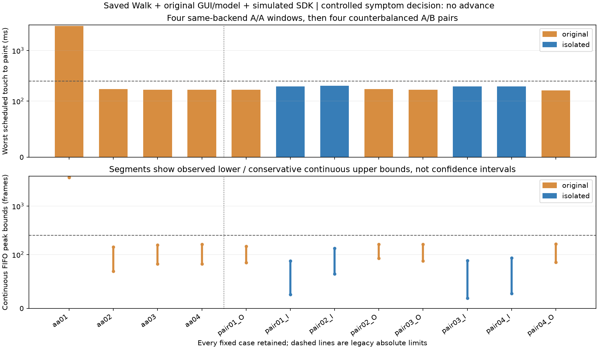

# 固定12窗结果：不推进隔离修复；优先解释首窗慢态

`plan02`固定的4个A/A及4对A/B全部执行，没有替换、追加或重启任何窗口。任务退出0，270文件归档SHA256为 `6bb7407cdddb8a620015baa7f3797ed75ccca749379b262d27e960d583591fb6`；独立review对全部12窗重新核对完整原始帧、报告、quality/runtime/audit/timeline/mirror/rawarchive状态及实际角色/时钟/资源，全部一致。

**冻结症状决定：advance=false。** 配对阶段严重原版为0/4，未达到原≥3/4门槛；四对隔离版本都没有改善总显示延迟，亦未达到20%改善门槛。旧3%/1%扰动失败、原生栈失败、field_fix_verified=false与primary_root_identified=false保持原结论。

## A/A首先暴露明显的运行状态变化

| 相同原版入口 | 计划接触→绘制最大ms | 连续FIFO峰值界 | 接触前模型推理中位数ms |
|---|---:|---:|---:|
| aa01 | 3043.110 | 3870～3934 | 38.800 |
| aa02 | 171.856 | 69～144 | 22.149 |
| aa03 | 167.722 | 83～158 | 22.235 |
| aa04 | 167.848 | 83～163 | 21.910 |

这些状态变化出现在引入任何隔离候选之前，且模型墙钟耗时差异在首次计划接触前已存在。不能把后续低延迟解释为隔离生效，也不能从“启动ready”推定实际执行状态一致。上述model耗时含等待，不是纯原生核CPU时间；没有证明独占GIL、CPU频率或Qt同步是其具体原因。

四个A/A显然不宜直接视为同一个平稳分布；result01中的log标准差和近似t宽度只是保留的描述值，不作为有效精度承诺或OFF/ON扰动验收。

## 进一步利用已有调用边界

已有adapter_calls与inferences按毫秒时间戳一一对应，并核验实际线程及严格嵌套时间区间。全部12窗的基类输入都是360×640×3的uint8，所有记录都返回了pose；不能用“后续完全没运行模型或没找到人”解释差异。

| A/A窗口 | 基类适配器区间中位ms | 外围区间中位ms |
|---|---:|---:|
| aa01 | 37.342 | 3.164 |
| aa02 | 20.993 | 1.792 |
| aa03 | 20.886 | 1.806 |
| aa04 | 20.842 | 1.813 |

基类入口是 `MediaPipePoseAdapter.infer_bgr`，覆盖RGB连续数组构造、MediaPipe Image、detect_for_video及landmarks转换；外围覆盖Preview缩放、调用分派和基类标记之外的观察器事件提交等。两个区间都可能包含等待，外围不等于纯cv2.resize，基类不等于纯推理核。各中位数独立统计，不能相减拼出函数贡献百分比。

该复核把剩余问题收敛到现有模型调用链边界，仍未区分具体内部操作、GIL重新获取与CPU交付。动态取帧历史和MediaPipe内部tracking/detection工作也未证明一致；不从相同尺寸/pose存在推断完整工作量等价。详见adapter_boundary01.json与boundary_plan01.json，没有新采集或改动原程序。

## 配对阶段：两侧均处于低积压状态

| 配对 | 原版最大计划延迟ms | 隔离最大计划延迟ms | 原版FIFO上界 | 隔离FIFO上界 |
|---|---:|---:|---:|---:|
| 1 | 167.106 | 194.600 | 148 | 88 |
| 2（BA） | 172.302 | 200.421 | 163 | 135 |
| 3 | 167.384 | 194.650 | 164 | 89 |
| 4（BA） | 162.870 | 196.512 | 165 | 94 |

隔离方案在这些快态窗口中的deque界更紧，但总绘制延迟更大，不能以队列指标代替最终实时性。所有候选都低于旧250帧/250ms绝对参考，所有配对输入迟发符合旧150ms门槛；这不补足严重基线未复现，更不能将A/A首窗与后面的候选拼成一对。result01中的几何变化是受观测快态窗口的点描述，不是严重积压状态的修复收益。

所有窗口的实际视频选帧、推理、SDK决策和绘图次数都保留，未事后配平。相同源码/政策不保证动态工作数完全相同。所有进程/线程状态读取和“前台是本窗GUI”模式均通过冻结要求；0控制mask只是已读取的配置，不是实际CPU频率或持续调度/同步状态的证明。

## 工程与归因决定

1. **暂停进一步扩展测量IPC接口或把原型推广成正式修复。** 目前只证明能完整交付，以及快态下FIFO有界，没有证明能稳定消除严重态积压。
2. **不再给同一计划追加窗口凑基线。** 严重A/A首窗和所有快态窗口同等保留，旧GUI QoS“只有第一原版严重、后续自行恢复”的证据未被覆盖；本次再次加强了首窗运行状态差异这一问题。
3. **优先离线解释首窗状态与接触前模型耗时变化。** 原计算负担与真实GIL等待的历史证据仍成立，但当前数据不允许指定主导持有者、具体责任函数或贡献比例。CPU交付、原生计算/内存、GIL与Qt同步仍须区分，不把配置回读当作实际交付证明。

没有新增人体、真实USB、Run或正式程序修改。后续先用现有数据和已有系统记录，不立即请求真人测试或重跑同计划。完整目标仍未完成。

## 资源与故障保全

- 共398256帧保存源交付，12窗各33188帧全部原始字段与完整状态通过，72个接触阶段角色上下文读取通过；49个锁保留，所有目标实际退出后才归档，只移除本次已Ready/result0任务。
- 458正式文件、冻结输入/依赖/原生库未变；WPR未记录，采样间隔10000×100ns。模型原返回未关闭的状态逐窗保留，额外尾部最终确认不能改写原返回边界。
- 本地观察器的PowerShell字符串扩展属性解析及共享读取问题只影响观察；仅中断并修正本地观察进程，Windows PID23528及其创建时间始终指向同一cohort，未重启实验。
- 第一归档器在检查正式基准前误引用stack_plan02而停止，未写出audit/manifest/archive。保留旧collector及失败记录，以独立collect02和collection_plan02绑定原stack_plan01哈希，检查全部原门槛后首次生成成功归档；没有覆盖失败记录或重新采集。
- 按保留UTCanchors边界前后各2分钟只读查询现有processor-power、kernel-power、user-mode power及Defender扫描开始/结束日志，均无匹配事件。这不排除实际频率、调度、实时扫描或其他后台资源状态变化，也不能证明系统没有干扰。

原始npz、视频及完整归档只留用户本地/Windows忽略目录；仓库提交派生结果、图、独立复核和失败记录。
