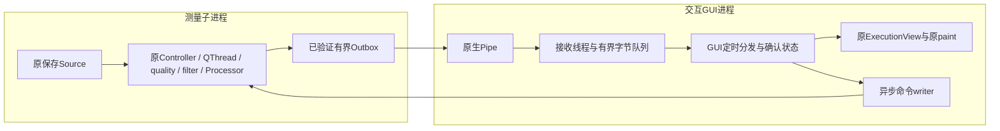

# 实验GUI代理：原执行视图真实绘制与完整会话交付通过

`629a446` 已补齐既有部分报告的原实现重算。本阶段第一次让测量actor的原会话结果进入**真实原ExecutionView/原绘图**，只执行冻结的一个保存输入窗口，不加载相机、视觉模型或SDK，不做性能A/B。

## 实际路径与结果

GUI PID18160，actor PID7600；GUI实际Session1、BelowNormal(16384)、Qt平台windows。原controller/engine/滤波/Processor、NumPy和绘图源文件不变，没有安装绘图候选。paint观察包装始终先调用原paint，再记录已确认contact_id。

- **33188帧**原始字段完整，完整report及quality/runtime/audit/timeline/mirror/rawarchive状态与保留的原GUI基准一致。
- GUI实际确认全部 **689条** actor输出，父发3条命令与actor收到计数一致；readiness与started、停止完成、报告值、payload_end有序。
- 原paint实际执行 **434次**，报告中全部 **9个active publication ID**（0、2、4、5、6、7、8、10、11）均在原画面paint路径出现。它们是发布ID，不能解释为真人步数或9次独立实验。
- actor退出0，reader/测量QThread/actor输出writer已确认停止；GUI接收线程与命令writer已退出，接收队列清空。独立本地 `review01.py` 复核通过。

消息全部交付不表示每条消息都独立paint；Qt原有update合并保持，未在桥接中自行丢弃/合并消息。paint见证也不是像素级历史一致、人体识别或临床真值证明。

## GUI状态与非阻塞边界

GUI只在确认started后设置is_running，不把start入队当作运行；command_completed必须确认原reader/QThread停止，report不得先于停止确认。payload_end明确仍未确认传输，必须收齐全部序号、确认actor实际退出及本地完整状态后才完成。

控制命令由独立writer写Pipe，GUI不等待actor或管道；接收线程先收字节，GUI每5ms最多分发8包，未使用每包无限Qt排队信号。接收队列上限128包/8MiB，另允许一个待入队接收包≤8MiB；调用方/unpickle对象和OS缓冲不在该字节上限中。本窗队列峰值5包/4654212字节，不能当作总进程内存上限或扰动通过。

当前是**固定保存输入的实验接口子集**：is_running/is_paused/device_state/quality_status由actor消息维护；远程可变engine引用明确抛NotImplementedError。报告以验证过的dict交付，不伪装成原MainWindow使用的完整TestReport对象；prepare(config)、config/start_time/旧私有engine引用、完整壳层兼容尚未完成。不能直接替换正式SessionController。

## 尚无完整GUI负载/性能结论

ExecutionView配置后立即停止自动相机启动，禁用相机面板及选择按钮，并实测preview/capture/vision/control均未启动。actor使用原保存Source的SDKready fixture旗标，**不是真实SDKready握手**。本窗不比较视觉/SDK并发、不估计contact→paint或GIL/CPU份额，也不提供原3%/1%资格。

下一步只对接原视觉/模拟原生SDK协议与actor的外部ready、源anchor/arm重基时钟握手，并保留实际视频选帧/推理/SDK工作及模型关闭证据。随后另行冻结完整GUI并发对照，仍要求原始数据/质量/报告一致、1000Hz队列与显示时延以及严重基线复现。当前不能宣布现场根因或正式修复。

## 预检失败与保全

环境查询quser不可用，改读Explorer会话作为准备线索；它不是解锁或前台证明，实际GUI会话和paint另行核验。第一版Windows预检用默认GBK读取UTF8的中文gui01源码，编译检查失败，尚未执行测试/GUI。保留原preflight.py/source01归档及preflight_failure01.json；新preflight02明确UTF8读取，运行源与计划SHA不变，未改验收门槛。本地12项及修正后Windows12项测试通过，随后才生成通过凭据并唯一启动窗口。

32文件归档逐项SHA复核，SHA256：`08373942b231ed310f0ebf5a986e2fe5d6f02edfe5ca51446006beae2e7ee9e6`。三个锁保留，完成任务Ready/result=0核对后仅删除本次拥有的计划任务。collector确认无活目标、458正式文件与依赖/输入/oracle/原生库未变，WPR未记录，采样间隔10000×100ns。

旧父poll验证失败、writer未确认、全部历史窗口和校准失败仍保持原结论。没有人体、USB、Run或正式程序改动。原始npz与完整派生归档仅留本地/Windows，仓库提交代码、冻结计划及复核结果。
