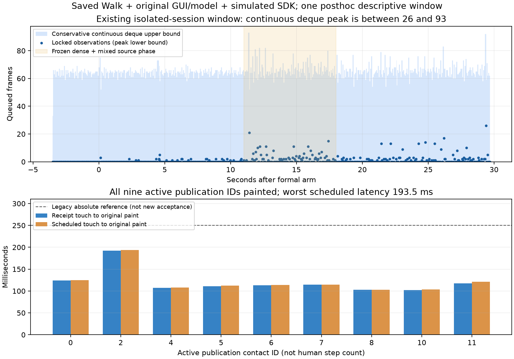

# 既有完整 GUI 窗口的吞吐与延迟：单窗低积压，尚无隔离收益归因

承接 `b189a18`。本阶段没有启动新窗口，只使用已经完成并归档的 `session_gui_vision/plan02` 窗口、历史原始保存输入及原有离线边界算法，回答“完整GUI实际工作时，测量子进程是否至少在这一窗跟上约1000Hz输入”。首次绘制观察失败窗口仍失败，不作为性能基线或合格样本。

## 当前实际证据

| 指标 | 结果 | 含义 |
|---|---:|---|
| 原始输入/完整报告/质量状态 | 33188帧，一致 | 原交付复核和本次原输入字段再核验 |
| 整窗实际receipt跨度速率 | 999.406帧/秒 | 保存输入平均交付速率，不能单独替代接触期实时性 |
| 正式输入最大迟发 | 70.216ms | 从原始记录间隔、两次source原点及arm重基独立重建due |
| 整窗连续deque峰值 | **26～93帧** | 26是观测下界，93是520个锁内FIFO见证给出的保守连续上界 |
| 观测到的最老pending最大年龄 | 11.965ms | 仅观测时刻下界，不当作连续最大年龄 |
| 接触receipt→原绘图最大延迟 | 192.526ms | 包含原算法确认、计算、等待、IPC与GUI |
| 计划接触→原绘图最大延迟 | **193.484ms** | 同时计入输入迟发，覆盖全部9个active publication ID |
| dense段6000帧进展速率界 | 985.217～1008.414帧/秒 | 由批完成时间界构造，包括计划空闲，不是CPU忙服务率 |

原视频/模型/SDK仍有真实工作：818视频提交、415推理、702有效原骨架绘制、527跟踪决策。所有数据来自原始保留窗口，未追加采样、改变输入、重放选帧或配平工作数。

这个窗口的deque峰值上界及全部接触显示延迟低于旧协议的250帧/250ms参考，输入迟发低于旧150ms参考。**这些是事后描述性事实，不是新冻结性能试验通过**。`frozen_performance_acceptance_pass=false`，也不把交付通过追认成性能验收。

## 复核方法与界限

1. 校验已有70文件归档manifest及冻结源码绑定。原始 `raw_frames.npz` 从用户Windows只读取回本地忽略目录，SHA与原输入冻结值一致；本次结果另逐项比较sample/frame/bits/wire/valid_bits/drop字段。
2. 按原Source真实循环重建due：checked样本仍使用arm前原点，只有其后的样本使用重基原点；历史媒体原点必须等于原输入首个receipt。拒绝断序、时间倒退、错误原点与错误重基，不能以回读或拟合代替实值。
3. 复用既有 `validate_queue`、`bound_deque`、`event_bounds`、`host_bins`。所有pending年龄与实际原始receipt独立对照，共156个非空见证匹配；未把空deque当作消费者无在途工作。两侧批完成区间不插值。
4. 已有原实现离线publication_map提供逻辑raw-release trigger；每条active发布的event_id、touch、published与revision必须匹配后，才构造消费/发布/绘图区间。计划时间与receipt时间分别保留。
5. 新5项source时钟测试，以及既有FIFO上界与游标边界回归套件通过，结果见tests01.json。图中散点是观测下界，浅色区域是连续上界，不能读为实际队列一直有约64帧。

在连续、无issue的固定保存源、单调FIFO见证和有限EOF已经闭合的条件下，93帧是整窗deque峰值上界；不自动推广到真实USB或混有issue的队列。pending不包含已经pop的批次；时间区间不是CPU/GIL/Qt各自耗时，不能据此计算责任比例。

## 还不能得出的结论

历史GUI QoS四个原版窗口只有1个严重积压，其余原版也自然很快。本窗没有同期匹配的原版，因此既不能估计“隔离降低多少百分比”，也不能确认低积压由隔离引起。真实人体/USB、正式集成、持续长时间吞吐和模型原返回未关闭问题均未获新资格。原3%/1%观察器失败及所有原生栈失败继续保留。

下一步收敛为共同GUI下的原会话同进程／测量子进程对照，先完成最小原版接入和两侧完整语义核验，再冻结固定预算的A/A方差、扰动及四对症状对照。不能拿本窗和旧严重窗口凑一对，不能通过追加原版轮次凑够严重基线。比较应明确是包含必要IPC的整体隔离方案效应；即使成功，也不能宣称独占GIL机制已被定量分离。无需现场真人操作。

所有新文件位于experiments，正式程序未改，目标保持进行中。
