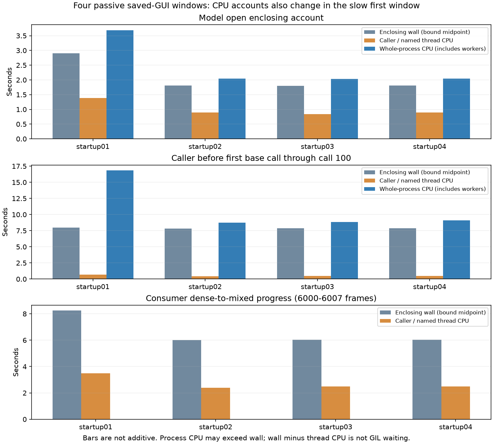

# 原GUI同窗CPU账本：慢窗同时增加墙钟与CPU记账，尚无根因占比

固定4窗全部完成，独立核对132752次保存源帧交付（每窗33188）、完整原报告/质量状态、原模型/SDK工作、48个CPU读数、时钟/身份和资源退出。没有补采、替换或设置干预。首窗符合冻结的探索性slow时序标签，后三窗fast；该标签不是频率、栈闭合或扰动资格。

## 同窗症状与原初始化CPU账本

| 窗口 | 接触前基类中位ms | 最大计划接触→绘制ms | FIFO连续峰值界 | open原方法墙钟ms | open调用线程CPU ms | open进程CPU ms |
|---|---:|---:|---:|---:|---:|---:|
| startup01 | 33.879 | 2550.334 | 2518～2578 | 2908.138 | 1390.625 | 3687.500 |
| startup02 | 20.144 | 166.424 | 67～133 | 1814.846 | 890.625 | 2046.875 |
| startup03 | 20.803 | 167.543 | 87～167 | 1798.926 | 843.750 | 2031.250 |
| startup04 | 20.001 | 166.547 | 71～150 | 1811.680 | 890.625 | 2046.875 |

CPU计数使用包围原方法的读数区间，原方法墙钟另外记录，不把读取本身塞进原函数耗时。进程CPU可大于墙钟，因为包含多个原生worker及同进程其他线程。open区间也可能与光栅准备重叠；不能把全部进程CPU归给模型。

## 消费者实际推进与CPU

| 窗口 | 实际批完成前缀区间 | 推进帧数 | 账本墙钟界ms | 该Qt工作线程CPU ms |
|---|---|---:|---:|---:|
| startup01 | 59906→65910 | 6004 | 8241.128～8241.367 | 3500.000 |
| startup02 | 59906→65906 | 6000 | 6000.638～6000.891 | 2390.625 |
| startup03 | 59906→65913 | 6007 | 6040.482～6040.656 | 2484.375 |
| startup04 | 59904→65904 | 6000 | 6041.630～6041.822 | 2484.375 |

慢窗推进6004帧所用墙钟约8.24秒，线程CPU约3.50秒；快窗推进6000～6007帧约6.00～6.04秒，线程CPU约2.39～2.48秒。新增证据不再只来自不同历史队列：当前同一GUI协议下，消费者CPU账本也随慢态变化。

这不是单个算法函数的CPU时间。该线程还运行原Qt任务/同步等，CPU账本可以包括忙等；快态墙钟还包括等待计划输入，慢态则有积压。严禁把wall−CPU叫作GIL等待，或据两个状态相减分配贡献比例。

## 模型调用线程与原生worker不可混淆

| 窗口 | 首基类调用CPU包围墙钟ms | 该调用线程CPU ms | 同进程CPU ms | 首调用前至第100次后进程CPU ms |
|---|---:|---:|---:|---:|
| startup01 | 86.630～86.900 | 15.625 | 281.250 | 16843.750 |
| startup02 | 36.747～37.039 | 0.000 | 78.125 | 8765.625 |
| startup03 | 36.599～36.851 | 0.000 | 93.750 | 8828.125 |
| startup04 | 34.611～34.827 | 0.000 | 46.875 | 9078.125 |

后三窗首次调用的线程CPU差值为0，并不表示没有执行CPU指令：GetThreadTimes在这种短区间粒度不足，cycles仍增长，模型实际返回且原生worker也在工作。这里的进程CPU还包括消费者、GUI等并发工作，不能解释为纯模型CPU。100次调用前后区间约7.8～8.0秒，包含帧间等待、resize、回调和全进程并发工作，不是100个基类内核的纯计数。实际帧历史/原生内部工作也未被证明完全相同。

## 判断收敛及边界

1. 首窗存在跨初始化、模型与消费者的运行状态差异；“全部只是额外阻塞等待”不足以解释CPU账本也增加。真实GIL等待的历史证据继续成立，没有被否定。
2. 现有数据仍无法区分原生执行路径/忙等、缓存内存、CPU交付以及具体同步机制，更不能命名真实GHz、热限制原因或具体责任函数。配置回读和CPU/cycles账本不是指令数或硬件频率测量。
3. 不追加本计划窗口，不优化IPC，不实施电源/优先级/亲和性/GC或正式程序改变。下一步优先复核已有全线程CPU/原生栈记录中未命名worker的覆盖与实际CPU证据，再判断是否还缺一个具体、有限的观察；不直接扩展通用采集框架。

## 质量与保全

全部48次实际native读取最大166.9µs，完整CPU capture最大194.0µs，均低于原1ms边界；含额外CPU读的context仍满足原50ms。原生/CPython CPU交叉检查、PID/TID/creation、单调性、实际工作计数响应、selected ordinal/adapter/时间包含和application_return不可变前缀检查均通过。此直接读取开销不是完整干扰反事实，**旧3%/1%、原生栈资格仍未通过**；不以本账本宣称定量CPU/GIL归因。

模型原应用返回时未确认关闭的状态逐窗保持false，额外尾部才确认最终退出。所有目标实际退出后归档；111文件归档SHA256为 `631909bbeab1806b3a7546300a8d95b4dcb1420718e22dccb892304db69a41ef`。17个锁保留，只移除本次已Ready/result0任务。458正式文件、输入、依赖/原生库未变，WPR未记录，采样间隔10000×100ns。原始npz/完整归档留在本地及Windows，仓库仅推送代码、派生结果及哈希。

完整根因与正式修复仍未完成。本阶段没有人体、USB、Run或优化A/B。
