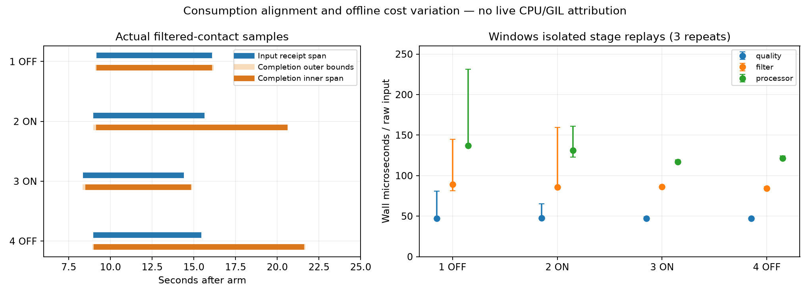

# Walk 四轮：消费窗口与原 NumPy 计算量离线诊断

2026-10-17；从 `22f073f` 建立 `codex/walk-offline-compute-diagnosis`。所有新增内容位于本实验目录，正式程序、`hardware/`、`engine/`、算法阈值、原 NumPy 和绘图候选均未改变。没有启动现场采集、GUI、相机、SDK、USB、ETW/WPR 或优化 A/B。

## 当前判断

**最值得继续验证的是：消费批次内的地面处理链（滤波、WalkingProcessor 及会话封装），在现场 GUI、SDK、USB 多线程环境中出现了额外的执行或同步成本；目前没有证据将其缩小为某个函数或 GIL。** 接触态确实更费计算，走完后保留的状态也增加成本，但四轮都有这种增长，不能由此解释慢轮特有的吞吐下降。

ON2 的接触样本已按时进入队列，实际消费却拖到输入结束约五秒后；OFF4 独立存在相同的排队现象。ON2/ON3 的滤波、质量成本接近，Processor 存在较小差异与重复波动，未重现现场接近两倍的进展差距；OFF4 的离线成本也没有慢轮特有的增长。**支持“数据负担增长不足以单独解释差距”，不等于证明“所有输入计算量相等”，更不等于确认同步等待就是根因。**



## 1. 先对齐实际处理的接触样本

先用原链路无计时地记录 `外层 raw sample → WalkingProcessor 实际收到的滤波 sample`，再按滤波后、原坏点掩码后仍存在活动光束的样本识别接触。不是按输入的一秒密集箱定义消费窗口。四轮滤波输出与正式归档均连续且数量相等，最大转交滞后 11 样本；四轮实际处理的接触样本各形成一个连续区间。

只使用 **consumer 自己批次完成后保存的 `queue_common`** 为外层 raw sample 完成时间作上下界。独立 `queue_samples` 可能在目标帧已处理但整批尚未结束时仍显示旧完成号，因此不作完成下界。首/末接触处理时刻分别有括号；外包络 `[首下界,末上界]`、内区间 `[首上界,末下界]` 均重新汇总 ETW，保留敏感性，而非用某个观测点冒充逐帧完成时刻。

|轮次|处理接触样本数|对应样本输入收件范围 s|消费外包络 s|消费内区间 s|边界最大括号 ms|
|---|---:|---|---|---|---:|
|1 OFF|6597|9.321–15.917|9.272–16.019|9.336–15.933|85.83|
|2 ON|6328|9.140–15.468|9.149–20.475|9.318–20.437|169.30|
|3 ON|5710|8.522–14.234|8.498–14.736|8.654–14.665|155.99|
|4 OFF|6145|9.140–15.284|9.101–21.512|9.172–21.440|72.29|

所有秒均相对各自 arm。接触定义是算法实际接收的光学状态，可能包含非脚部遮挡，不是人体步数真值。由此得到的接触样本窗平均进展范围为 978–1000、559–569、915–950、495–501 样本/秒；**这是新的离线描述，不能替换先前冻结的输入密集箱消费 fps 或用来宣布验收通过。**

包络内同线程完成观测的 pending 首→末约为 3→23、3→4989、0→464、2→6179；最后一个完成点对应帧年龄约 11、4986、464、6186 ms。这是完成帧年龄，不能偷换成最老待处理帧年龄。完整 `queue_common` 行、原 pending/oldest 字段与时间边界见 `aligned03.json`；原四轮脚印 P95/max 仍为 156/169、5020/5105、702/712、5376/5677 ms。

### 按新窗口重新汇总 ETW

|轮次|线程|Running 外包络/内区间|Ready 外包络/内区间|Waiting 外包络/内区间|
|---|---|---:|---:|---:|
|2|consumer|42.30% / 42.26%|7.51% / 7.49%|50.19% / 50.25%|
|3|consumer|43.72% / 44.06%|8.09% / 8.09%|48.19% / 47.85%|
|2|GUI|54.00% / 54.02%|3.88% / 3.87%|42.11% / 42.11%|
|3|GUI|55.33% / 55.19%|3.93% / 3.87%|40.74% / 40.94%|
|2|reader|22.15% / 22.14%|8.05% / 8.02%|69.80% / 69.84%|
|3|reader|16.15% / 15.99%|9.23% / 9.23%|74.61% / 74.77%|

Transition/Unknown 的极小余量完整保留于 JSON。内外边界不会改变“consumer 约一半 Waiting、Ready 未占主导”的描述。相应 consumer 调度驻留/接触样本约为 ON2 743–757 µs、ON3 464–478 µs，**只是含边界误差的驻留代理量，不是阶段独占 CPU**。

沿用 `22f073f` 已验证的 CSwitch v5 / ReadyThread v2 解码、逐 CPU/线程切换链、生命周期、零丢事件及 QPC/FILETIME 同步；此次重读核验二进制 SHA 和时钟锚点。原独立 GetThreadTimes 与 CSwitch 驻留不等值的问题仍存在（约 3.6%–22.8%），没有通过改窗或归一化抹平。ReadyThread header 无法识别唤醒者，原始等待原因 6 无法辨认锁或 GIL。

消费内区间里，已有低频探针可见 ON2 1 点、ON3 3 点同时满足 pending>100、批次在途、consumer Waiting、距状态边界至少 0.1 ms。只能证明这些观测点的批次内等待，探针自身可能竞争 GIL，不能当无偏等待比例。consumer 的 4–6 ms 未运行间隔分别 100/84 次；单位时间分布与输入、同步均有关，不能由“约 5 ms”确认 GIL。

同一消费内区间中完整包含的既有视觉观测区间，有效骨架/节点/连线每秒约为：第 1 轮 18.60/184.56/184.16；第 2 轮 16.00/154.73/152.03；第 3 轮 18.09/167.85/162.22；第 4 轮 15.31/142.28/136.85。较快的第 3 轮绘制次数更多；不能据次数单变量归因，也不能假设每次 SDK/绘制成本相同。**ON 状态只解释 ON2/ON3，不外推给 OFF。**

## 2. 原链路语义门槛及成本测量范围

`replay.py` 使用 QCoreApplication，无事件循环、无设备。输入提前解压并构造，按原记录的 receipt 时钟、stream/layout/wire/valid/quality flags 和原 checked sample 完成准备、arm、处理、结束及报告。配置保留 `starting_foot="Not defined"`；未按口述左右脚更改算法输入。

无计时的原链路 pass 捕获阶段顶层调用带。分别复算：

- **质量**：原 DeviceQualitySession，包含正式运行 NumPy runtime 质量检测、mask/project、Qt emit 与收集器；准备阶段单列，不计入 formal。
- **滤波**：原 GroundStabilityFilter 的 feed/reset/flush，包括 mirror guard 与原 NumPy `_feed`；只录外层调用，不重复计算内部嵌套 flush 等时间。包含结果收集成本。
- **Processor**：原 WalkingProcessor 的 process、会话额外强制 `_record_visual`、约 10 Hz summary、末尾 build_report，按原先顺序。内部嵌套调用只计在父调用中。未省略 summary 来获得更小数字。

三个阶段计时相互独立；没有把 quality 包含下游的时间再加 filter/process。输入/调用带制作、文件读写、结果序列化与严格对照放在计时外。每 1000 个原始样本边界读取一次墙钟/线程 CPU，**没有逐帧计时、cProfile 或高频 Python 调用树**。四轮与阶段按次序轮转，各三次；所有正式源文件逐个 SHA 校验。Windows Python 3.11.5、NumPy 2.4.6，同源基线；Mac 只作独立语义/映射预检。

独立阶段不包含会话归档、`uncertain_contact`、snapshot/visual 构造及 GUI/SDK/USB 竞争；调用带、预构造输入与结果保留也改变缓存、分配和 GC 环境。因此再用 `chain.py` **不安装任何方法包装器、不使用调用带**，完整执行 `DeviceQualitySession → GaitEngine/OvergroundSession → 原滤波 → WalkingProcessor`，保留原归档/快照/Qt 同线程信号，按同样千样本边界计时；末尾排空/报告单列。Windows 同时读取低频 QueryThreadCycleTime 原始 cycle 计数，不换算秒数，不冒充指令数。

### 严格等价结果

四轮原始帧/线协议解码、设备计数、完整原始归档、无丢弃尾帧、质量历史/全部事件与上下文、runtime counts/transitions/healthy/window SHA、原事件审计、未掩码 timeline、镜像保护历史及**完整报告全部字段**均通过。只去掉原 report.json 本来就不保存的 `export_frames/export_timestamps`；其对应原始归档另行逐字节/时间戳核对。未忽略时间戳、未删事件或调整浮点容差来凑相等。

Windows 与 Mac 的四份完整报告 canonical SHA、原输入文件 SHA 及 raw→processor 映射文件逐字节一致。阶段三次复算每次再次校验输出与语义。`integrity01.json` 是对已有四轮重新执行原完整性检查的结果。

OFF4 初次只复算 frame 时少了一条 `data_timeout`。原数据表明最后 raw receipt 至排空完成为 1.759 s；原质量历史确实有末帧处超时。使用保存的最终排空时刻执行原 `quality.poll()` 后，全部字段匹配。这里只重建该末尾检查的**结果**，其实际派发时刻未保存，不能声称还原了精确 poll 时间，也不将这个终端检查计入接触成本。

### 阶段累计线程 CPU（毫秒，中位数与三次范围）

|轮次|质量正式 frame|滤波正式调用及尾 flush|Processor 调用含末尾报告|
|---|---:|---:|---:|
|1 OFF|1969（1969–3328）|1594（1516–3375）|3219（2781–4750）|
|2 ON|2328（1859–2406）|1469（1469–2516）|2516（2516–3766）|
|3 ON|1859（1844–1891）|1469（1422–1953）|2422（2328–2469）|
|4 OFF|1875（1844–1953）|1469（1453–1484）|2266（2266–2281）|

这些总量覆盖不同长度的原始样本（43224 /40427 /40546 /40956），末尾范围也不相同，不能只比较总量判断单位成本。Windows GetThreadTimes 实际结果有约 15.625 ms 台阶，千样本块可能出现零/一跳；阶段累计、墙钟和整链 cycles 交叉列出，不能给单块 CPU 微小差异赋予虚假精度。

### 完全接触核心块的单位成本

固定离线描述：一个完整 1000 raw 外层样本块中，恰有 1000 个 Processor 输出，且每个都有可用接触。每轮恰选出五块；1/2/4 轮为正式设备秒块 10–14，3 轮 9–13。这里仍非相同位图或相同姿态。各阶段下表为墙钟 µs/输入，中位数（最小–最大）；不含末尾报告，不由现场 Running 反推。

|轮次|质量|滤波|Processor|
|---|---:|---:|---:|
|1 OFF|47.02（46.76–81.05）|88.91（81.15–144.68）|136.93（136.28–231.30）|
|2 ON|47.79（46.86–65.30）|85.93（85.17–159.41）|130.97（122.83–161.16）|
|3 ON|47.04（46.94–48.93）|86.00（85.84–86.67）|116.78（116.71–119.47）|
|4 OFF|47.19（46.98–48.04）|84.39（83.11–86.45）|121.17（120.93–124.18）|

初始空场的滤波约 27–29 µs/输入、Processor 约 20–21；接触时分别约 84–89、117–137。空场尾部 25–29 秒 Processor 仍约 53–64，高于初始空场，说明保留状态确实有成本。Quality 核心约 47–48，各轮相近。

ON2 Processor 的中位数比 ON3 高约 12%，但 ON2 本身有约 31% 的 min→max 范围，首两轮离线还出现多个阶段共同变慢；没有记录当时频率、缓存或宿主状态，不能指定原因。保留所有三次结果，没有事后删首轮或把最后两次改称预先冻结的预热组。**离线微小差异与样本数不足以建立稳定排序，更不能解释成现场 CPU/GIL 占比。**

### 原始完整同步链交叉检查

Windows 原始整链三次均完整报告、质量历史、事件和 timeline 等价，源码运行前后 SHA 不变。核心块结果如下；完整 frame 处理与末尾排空/报告分开，未将三阶段总量相加来替代整链。

|轮次|整链墙钟 µs/输入：中位数（范围）|线程 CPU µs/输入：中位数（范围）|原始 cycles/输入：中位数（范围，百万）|
|---|---:|---:|---:|
|1 OFF|575.67（328.07–575.79）|568.75（321.88–575.00）|1.372（0.786–1.374）|
|2 ON|559.13（555.32–612.37）|556.25（543.75–600.00）|1.335（1.318–1.458）|
|3 ON|554.82（554.77–586.11）|543.75（540.63–581.25）|1.323（1.322–1.396）|
|4 OFF|549.46（548.77–553.77）|546.88（543.75–550.00）|1.311（1.301–1.323）|

ON2/ON3 整链核心中位墙钟仅差约 0.8%，原始 cycles 中位数差约 0.9%，范围重叠；同一 OFF1 输入和状态却在重复间出现约 1.75 倍单位成本波动，进一步说明数据本身不是唯一变化因素。cycles 并非指令数，频率/平台记账方式未校准，不能据此选定频率、缓存、GC 或虚拟化原因。整链无 GUI 竞争时 CPU 与 wall 接近，也不能推断现场 Waiting 的成分。

整链初始空场约 189–192 µs/输入，接触核心约 549–576，后期空场约 309–329。这保留了接触和已有状态的成本增加，但四轮慢/快的排序仍不成立。整链大于独立阶段的数值**不能相减后把差额命名为某个函数耗时**：范围和运行时条件均不同。原会话里的 `uncertain_contact` 会读取计算得到的 layout.positions_m，归档、Qt 信号、快照/visual 封装等也没有包含在独立 Processor 带中；现有阶段数值不能将这些排除或宣布 Processor 独占了现场 CPU。

完整结果为 `windows_chain01/chain.json` 与 `chain_summary01.json`。这次整链补充的目的就是防止“独立阶段成本很低，所以现场代码无需计算”的测量假闭环；**现场执行时间、GIL/锁等待及 CPU 交付比例仍需原生证据，不能从这些离线 µs 相减推算。**

## 3. 状态增长与根因排序

千样本边界计数（不是逐帧峰值）中，四轮源回看缓存最高均为 31，滤波待回溯队列为 10；active 为 2/2/1/2。最终 contacts 16/16/17/12，ownership groups 7/6/5/5，contact position samples 430/417/378/389，event audit 43/53/48/39。timeline 随时长增加，最终约 772–838。contact 数包含算法候选，不是物理步数。

- **已证实**：接触/已有状态使滤波及 Processor 比初始空场更贵。质量、滤波、Processor 的完整语义能离线重现；没有慢轮特有的数量级状态增长。
- **较支持**：在这些已有 Walk 样本上，慢/快轮的差异不能仅由原始位图驱动的累计计算需求解释。ON2/ON3 的单位质量/滤波相近，Processor 差异远小于现场进展差距且存在重复波动；OFF4 的离线成本与“现场较慢”的排序不一致。
- **优先假设**：接触态地面处理链及会话封装的执行与同步边界，在 GUI/SDK/reader 并发时放大了单位样本服务成本。可能包括 GIL/其他同步、原生库执行、分配/缓存/频率及 CPU 交付差异；没有可用栈、锁持有者、指令数或频率证据来单独选中某项。
- **仍未排除**：会话封装/GUI 回调/SDK 自身的状态成本与调度影响。无设备整链只检验顺序路径，不能再现现场竞争；CSwitch 的 Waiting 也不等于 Python GIL。现有证据不支持直接实施 NumPy 替换、滤波/Processor 重构或绘图移植。

## 4. 下一步只建议一个最小验证

**保留原单 USB Walk 拓扑，在下一次允许原生记录且实际出现积压时，截取短窗口的 consumer CPU/等待栈证据。** 先离线核对该 Python/Qt/NumPy 二进制的符号是否足以区分 `take_gil`、Qt/系统同步与计算内核；符号不足时不能靠 Waiting 猜测。随后独立校准低频原生 CPU 采样与必要的 CSwitch 栈记录，核对线程 CPU/cycles，并解释 ISR/DPC 与驻留计费差额。仍以已完成接触样本、批次在途和 pending>0 对齐。

判别预期：若积压中反复停在 `take_gil` 等可辨认锁路径，才提高相应同步根因可信度；若栈主要在具体计算函数且 CPU/cycles/单位样本工作显著增长，则转向该计算路径；若频率/CPU 交付或未解释驻留差额主导，先修正执行环境/测量解释。**新增原生栈记录必须先证明扰动可接受；校准失败就保留失败，不继续归因。** 这是后续方案，本轮没有启动或要求新的现场采集。

现阶段增加普通 Run 只会同时改变 Processor、接触密度与人体/SDK 运动，不能直接区分上述假设；不为此追加现场 Run，也不启动优化 A/B。若必须用固定输入离线完整 GUI 先做原生记录校准，只保留一个回放输入源，并先证明症状可复现；不能引入真实第二 USB 再把结果当正式单输入链路。

## 5. 保存与复核

Windows 新隔离根：`E:/OptoJump/IronJump-walk-compute-offline-20261017-01`。原输入仍只读引用 `IronJump-single-usb-human-etw-20261017/experiments/single_usb_human_etw/runs`，没有覆盖旧采集或上轮 ETW 解码。完整原生 ETL/解码仍保留上轮 evidence 和 Windows 目录。

主要结果：`windows01/compute.json`、四个 `_output_map.npy`、`windows_summary01.json`、`aligned03.json`、`integrity01.json`，`windows_chain01/chain.json`、`chain_summary01.json`。脚本 `replay.py`、`chain.py`、`align.py`、`summarize.py` 均拒绝覆盖已存在输出；部署/输入/结果 SHA 见 manifest。Mac local*/debug* 与早期图/窗口输出保留本地但排除提交和结论；最早输入预构造误在循环中重复解压 NPZ 后中断，计时尚未开始。第四轮缺终端 poll 的未通过版本也未进入结果。local_chain01 运行末尾期间编辑了脚本，因此该输出排除；Windows 正式版本在运行前冻结 SHA，运行后再核验。

复算（每次选择不存在的新目录；不要调用 Windows 部署脚本重用已有根）：

```sh
python replay.py --input <existing-runs> --output <new-stage-directory> --repeats 3
python chain.py --input <existing-runs> --output <new-chain-directory> --repeats 3
python align.py <new-stage-directory> <new-alignment.json>
python summarize.py <new-stage-directory> <new-summary.json>
python summarize_chain.py <new-chain-directory> <new-chain-summary.json>
python -m unittest discover -s experiments/walk_compute_offline_diagnosis -p test_alignment.py -v
```

原四轮数据可以继续作为后续脚步算法的固定回归集。口述标签保持：左先 11、左先 11、左先 10、右先 11；未用这些标签改写报告。总步数和首脚不足以充当逐步时间/触地真值，应结合已保存原始录像另作逐步标注；这些有限样本不能保证未来所有工况都无需现场测试。末步漏发布、有效步间隔计数与人体步数仍属独立正确性任务。
